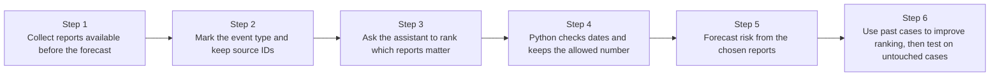

# DSPy context-selection workflow (synthetic pilot)

## For a senior MLE

```mermaid
flowchart LR
    A[Point-in-time inspected evidence<br/>source ID, event type, available_at] --> B[Local cutoff and metadata allowlist<br/>alias, category, age in days]
    B --> C[DSPy ContextProgram.rank<br/>instruction optimized by GEPA]
    C --> D[Python select_context<br/>validate IDs, cutoff, budget]
    D --> E[Runner.score<br/>fixed scoring policy and selected evidence]
    E --> F[Residual MSE metric<br/>train feedback only]
    F --> G[GEPA candidates]
    G --> C
    G --> H[Validation chooses instruction]
    H --> I[Frozen program and sealed test]
    D --> J[Receipt: selected IDs, skill hash, budget]
    J --> E
```



The new module changes **selection of inspected evidence**, which is the actual
context passed to `Runner.score`. It does not optimize the existing scoring
policy in `optimize.py`. `compile_context_program(rows, scorer, max_events=...)`
uses train and validation rows to optimize the ranking instruction against the
existing fixed scorer; `runner_forecast_scorer` adapts `Runner.score` as that
scorer. `Runner` accepts the selected program via its `context_program`
parameter. The optional OpenAI Responses adapter uses a
forced `select_context` function call; the provider receives only local aliases,
approved event categories, and age in days. The Python tool verifies the call and
constructs the selected packet locally. For the DSPy path, the host likewise
executes and independently verifies `select_context`; a prompt by itself is
not the enforcement mechanism.

## For Agostino: six step panels



The assistant may suggest an order. Python decides what enters the forecast.
The test outcome is used to compare ranking rules; it never rewrites a past
source or makes a graph link into causal evidence.

## Synthetic test report, 2026-10-22

Run:

```bash
uv run --no-project --python 3.12 --with 'dspy==3.4.0' --with 'gepa==0.1.4' \
  python -m unittest discover -s examples -p test_dspy_context_selection.py
```

The tests were written before the corresponding implementation and observed
failing imports or assertions. The local GEPA test uses eight synthetic cases:
four training, two validation, two held out. Its fixed toy scorer maps a
selected supplier disruption to unit risk; all toy targets are unit risk.
With a one-event budget, the seed selects routine news (score 0/1), and GEPA
changes the ranking instruction so validation and held-out cases select the
supplier disruption (score 1/1). Nine other contract tests check the Python
tool, cutoff, budget, missing or duplicate IDs, skill loading, scoring-packet
filtering, and forced OpenAI function-call configuration. All tests use a local
fake model or client and make zero provider calls.

The existing 25 design tests and the prior offline DSPy pilot also pass.
The forecasting dictionary validator returns `QUALIFIED` with zero package
manifest mismatches; historical source hashes remain recorded separately.
These homogeneous toy cases verify plumbing and direction of context change,
not empirical forecast performance or generalization. The historical runner
still needs licensed source caches, outcome files, a real provider, an approved
preflight, a development-only optimization job, and a frozen held-out test.
Do not represent this pilot as a reproduced paper result.
