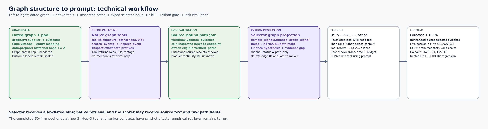
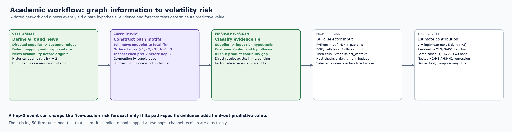

# Graph-conditioned context optimization: design and test status

## What is being predicted

The existing 50-firm experiment predicts the **next five exchange sessions'
log mean squared daily total return**, relative to a development-only OLS
anchor that includes GARCH and known numerical controls. This is a risk or
volatility proxy, **not directional return prediction**. A return-direction
study needs a separate label, loss, calibration, and protocol.

The proposed graph-specific information is: a time-eligible event at a
*different* company, connected to the focal company by a typed FactSet path,
with evidence for the product or demand channel where available. The same
article, the focal firm's own news, and common macro news must not be counted
again as an incremental network discovery. A graph path is initially a
retrieval lead; it becomes a **conditional channel** only after separate
source-bound event and target-exposure facts pass `check_network_channel`.
That direct-path receipt does not validate two- or three-hop transmission:
each intermediate needs source-bound evidence that the affected item continues
along the chain. Even a valid receipt does not establish materiality or a
causal effect.

## Senior MLE: data, tools, optimizer, and estimand



**Status:** The completed 50-firm code constructs graph-conditioned retrieval
pools only through **two hops**. The underlying graph can enumerate three hops
after an inspected `via` intermediate. This PR lets the toolkit stage
first-, second-, and third-hop evidence when a three-hop relation is supplied,
and passes a three-hop role sequence to DSPy as `path_only`. Synthetic tests
cover that path; the historical candidate pool does not contain third-hop news.
The later `network50_evidence_toolkit.py` implements `check_network_channel`,
but it was **not part of the completed 50-firm run** and checks direct links
only. This PR's executable pilot optimizes the ranking/selection of already
inspected events. Its bins carry no revenue weights, raw graph IDs, or claim of
product-channel verification. The graph-tool routing optimizer and the
multi-hop conditional-channel branch remain future implementation.

## Academic-facing flow: graph, mechanism, and estimand



Both figures read **left to right**. White panels show ordinary data processing,
selection, and evaluation; colored bold elements mark the supply-chain graph,
path motifs, and finance hypotheses. The third-hop lane is an implemented
tool/selector contract tested on synthetic paths, not an observed third-hop
result from the historical 50-firm run.

## How graph structure enters the prompts

The pipeline has two distinct model boundaries; it does **not** paste an
adjacency matrix or the whole graph into a prompt.

| Boundary | Crucial Python and Skill | Graph information delivered |
| --- | --- | --- |
| Evidence retrieval | `news_network_50_2025.workflow.Runner.evidence` prompts the native agent to call `Toolkit.exposure_paths`, `search_events`, and `inspect_event`. `news_network_50_2025.toolkit.Toolkit` returns dated, typed path steps, edge IDs, graph vintage, and hop count for the selected relation. | The agent receives full path records in **tool results**, follows exact inspected prefixes, then reads source passages at the endpoint. A path is a search lead; a source passage is needed for the event. The retrieval prompt has its own graph instructions; it does not load the Skill file. |
| Evidence join | `workflow.validate_evidence` joins the inspected source to the path endpoint and attaches `verified_paths`; `workflow.apply_context_program` assigns `_scope`. | Host-side source and path receipts stay attached to the candidate. Historical `data.prepare` created a pool through two hops; staged third-hop tool use requires an inspected second-hop `via` entity. |
| DSPy selection | `context_selection._model_metadata` calls `domain_signals.finance_graph_signal`. `ContextProgram` uses `dspy.ReAct`; the model must call `use_supply_chain_context_skill` to read the local `SKILL.md`, then call Python `select_context` exactly once. The host checks the order and receipt; `select_context` enforces cutoff, IDs, and budget. | Only a local alias plus allowlisted event/graph bins enter `RankEvidence.candidates`: `event_type`, `age_days`, `scope`, `graph_role`, `hops`, `path_pattern`, `path_count_bin`, `channel_status`, `mechanism_hint`, `event_state`, `role_motif`, `finance_hypothesis`, `evidence_gap`, and `alternative_route`. No raw article text, firm/edge IDs, or revenue percentages enter this selector field. |
| Forecast and optimization | `Runner.score` builds the fixed scorer packet from selected full evidence; `compile_context_program` applies GEPA feedback to the selector instruction. | The scorer sees selected passages and verified paths. GEPA changes ranking instructions, not graph-tool routing, graph data, Skill text, or the scorer. The selector's metadata projection is **not** an end-to-end privacy guarantee for retrieval or scoring. |

For example, a synthetic three-hop supplier lead can enter the selector as:

```json
{"source_id":"C1","event_type":"supplier disruption","age_days":1,"scope":"network_supplement","graph_role":"supplier","hops":3,"path_pattern":"supplier_to_supplier_to_supplier","path_count_bin":"one","channel_status":"path_only","mechanism_hint":"intermediate_product_unverified","event_state":"ongoing","role_motif":"all_upstream","finance_hypothesis":"upstream_input_risk","evidence_gap":"intermediate_product_continuity","alternative_route":"none_observed"}
```

The `path_pattern` encodes the ordered supplier/customer roles on the path,
while `path_only` and `intermediate_product_unverified` prevent that path from
being treated as proven shock transmission. This is the graph-specific
information DSPy can rank. A future multi-hop channel validator would need
separate source-backed product continuity at both intermediates before
promoting a three-hop mechanism claim.

The extra Python fields make that distinction operational: `role_motif`
classifies ordered graph direction, `finance_hypothesis` records only a
topology/event-aligned risk hypothesis, `evidence_gap` names the missing
exposure or intermediate continuity, and `alternative_route` describes
observed path topology without calling it economic redundancy. Conflicting
shortest motifs or an event category that does not align with the path produce
`unaligned_or_ambiguous`. These fields are deterministic, categorical, and
never computed from future returns or a model-written channel receipt. The
selector Skill gives separate rules for upstream, downstream, competitor,
mixed-direction, and co-mention evidence; the audit Skill requires dated,
source-backed links for stronger claims.

### Concrete selector tool sequence

The following is a **synthetic shape example**, not an empirical optimized
prompt or a provider transcript. The model sees allowlisted candidate metadata
and a task that names the two available tools:

```text
Task: Call use_supply_chain_context_skill first. Apply its finance and graph
rules, then call select_context exactly once with ranked C-aliases.

Model tool call 1: use_supply_chain_context_skill({})
Host tool output 1: reviewed local SKILL.md text (hash recorded locally)
Model tool call 2: select_context({"ranked_ids":["C1","C2"]})
Host tool output 2: {"selected_aliases":["C1","C2"],"selected_count":2,"tool_called":true}
```

`ContextProgram` uses `dspy.ReAct` for this sequence. Its per-invocation
session maps aliases to local source IDs, checks Skill-before-Python order, and
rejects missing or repeated calls. GEPA may revise the agent's finance ranking
instruction, but it cannot alter the local Skill file, tool code, cutoff, or
budget. The optional Responses adapter also forces the Skill read and Python
function as two sequential calls; neither route is a hosted Skill mount.

## Cumulative hop ablation and regression output

The new opt-in experiment uses the **same firm-periods, fixed seed policy,
controls, target, and provider model** at each radius. `data.prepare` can now
build a separate three-hop candidate pool with outcome-free 8/6/6 news slots
for shortest one-/two-/three-hop typed paths. `Graph.pool_paths` enumerates
offline candidates; the native `Graph.paths(..., hops=3)` and `Toolkit` still
require an inspected `via` intermediate during retrieval. The historical
two-hop pool remains separate.

`hop_ablation.scope_network_pool` gives `Runner` three cumulative capabilities:
**H1** sees only direct typed paths and their articles; **H2** sees hops 1–2;
**H3** sees hops 1–3. Co-mentions are excluded. A multi-tag article is available
at its shortest eligible typed hop. Each capability has its own evidence and
forecast cache key. Broad three-hop coverage counts are withheld from narrower
prompts; graph-related conventional controls for this new run use the direct
typed neighborhood at every radius. The run freezes all predictions before
reading test labels.

`hop_ablation/matched_test.csv` contains one row per test firm-period with
`OWN`, `H1`, `H2`, `H3`, label, anchor, fixed controls, exact-hop candidate
counts, and accepted-event counts at each radius. `scope_audit.json` retains
the same outcome-free coverage audit for training and test cases.
`hop_ablation/summary.json` and `REPORT.md` report raw residual MSE and nested
regressions. With common controls and `OWN` score in the base, the nested terms
are `H1`, `H2−H1`, and `H3−H2`:

`y_it = X_it β + γ_own OWN_it + γ_1 H1_it + γ_2(H2_it−H1_it) + γ_3(H3_it−H2_it) + ε_it`.

The output marks zero rank increments as
unidentified and reports both exploratory pooled test R² and coefficients
fitted on training dates and evaluated on the sealed test dates. These are
predictive radius contrasts; they do not isolate causal transmission. Wider
scopes may use more retrieval compute, so this ablation alone is not a
matched-cost comparison against generic retrieval.

On a prepared, reviewed **new** output directory, the commands are:

```bash
PYTHONPATH=source/code python -m news_network_50_2025.data --out /path/to/new_3hop_run --max-hops 3
PYTHONPATH=source/code python -m news_network_50_2025.run --out /path/to/new_3hop_run --smoke
# Review smoke.json and native traces; the existing toolkit_review.json gate must approve this manifest.
PYTHONPATH=source/code python -m news_network_50_2025.hop_ablation --out /path/to/new_3hop_run
```

No real three-hop pool, provider forecast, or empirical ablation was run in
this PR. Ten new synthetic tests pass and cover pool enumeration, news quotas,
capability isolation, complete-case joins, rank-deficient contrasts, and
frozen-regression calculations. The 22 DSPy, five staged-tool, and 25 existing
design tests also pass locally; the forecasting validator remains `QUALIFIED`
with zero package-manifest mismatches.

## Data contract and contribution test

| Stage | Required primitives | Output / boundary |
| --- | --- | --- |
| Graph | Directed supplier/customer edge, dated mapping, graph vintage, path steps and hops | Typed retrieval lead. Revenue percentage is not a target input-dependency weight. |
| Event | Inspected neighbor passage, source/story ID, article availability and event timing, contradictions/mitigation | Source-bound event fact. A title or firm tag alone is insufficient. |
| Exposure | Separate inspected facts about the affected item at the target and every intermediate; exact relation IDs and channel receipts | Current receipt is direct only. Two and three hops require product continuity at each intermediate. |
| Prediction | Own/common packet, validated network candidate, fixed controls and anchor, selected evidence IDs | Residual log-risk score; missing exposure remains unknown. |
| Evaluation | Train/validation/test by forecast origin, next-five-session CRSP target, fixed token/tool budget | Paired loss and cost against OWN, topical-news, industry-neighbor, co-mention and shuffled-path controls. |

The *incremental network knowledge* claim needs held-out improvement from
typed graph-conditioned evidence beyond own/common news and equally expensive
generic related-company retrieval. The paper cannot infer this from a toy
example, a high model score, or one path receipt. Report performance separately
for direct supplier, direct customer, competitor, two-hop lead, three-hop lead, and missing
channel strata. Track whether a selected source was already in OWN or a common
story, and whether a NET claim survives the channel gate.

For case `(i,t)`, let `y(i,t)` be the five-session log-risk label and `a(i,t)`
the training-fitted conventional anchor. With fixed scorer `s`, compare paired
losses `(y-a-s(OWN+graph))²` and `(y-a-s(OWN+generic))²` at the same tool and
token budget. A positive held-out difference in favor of `OWN+graph` is the
predictive contribution of graph-conditioned information **for this sample and
protocol**. It is not an estimate of shock transmission. Report the separate
comparison with `OWN` to show whether any network retrieval helps at all.

## Tool and Skill control

The local Skill states the finance task, graph evidence requirements, and
ranking constraints. `ContextProgram` exposes it through a local
`use_supply_chain_context_skill` tool; the **DSPy model must call that tool**
before the Python `select_context` function tool. The host verifies both calls;
the native evidence-retrieval agent currently follows separate instructions
in `Runner.evidence`, not this Skill file. The host must enforce capability
scope and verify call receipts. A prompt alone
cannot force a model to inspect an article or create a valid product channel.
For an OpenAI Responses deployment, the optional adapter forces two sequential
function calls with `tool_choice`: a local Skill read, followed by Python
`select_context`. It returns the Skill text as a tool output, with the response
ID and call ID carried into the second request. This is a **local Skill read**,
not a hosted-shell Skill mount. If `dspy.ReAct` is adopted for graph search, its routing
instruction can be evaluated under the same feedback protocol. The pinned
DSPy 3.4.0 API has no `enable_tool_optimization` switch, so automatic
tool-description optimization must not be assumed. The source, timing,
channel, and label-access validators must remain fixed.

## Synthetic test report, 2026-10-22

```bash
uv run --no-project --python 3.12 --with 'dspy==3.4.0' --with 'gepa==0.1.4' \
  python -m unittest discover -s examples -p test_dspy_context_selection.py
```

Tests were added and run red before implementation. The domain-signal tests first failed on a missing module; the graph-aware GEPA test then failed because the candidate instruction lacked `direct_supplier` and `path_only`. Both passed after implementation. A new red test exposed the missing Skill and Python model tool calls; the DSPy ReAct path now requires both. Three further tests were run red for multi-hop finance motifs, evidence gaps, and alternate paths, then passed after the Python projection was extended. The 22 context tests and five staged-tool tests pass. The original local GEPA
test has four training, two validation, and two held-out synthetic cases. With
a one-event budget, seed validation negative MSE is -1.0 and the selected
candidate is 0.0; two held-out toy cases select the supplier signal. New contract tests verify finance/graph signal bins, two- and three-hop gaps, mixed paths,
co-mention leads, pre-cutoff graph vintages, unknown statuses, aligned and misaligned multi-hop finance hypotheses, conflicting motifs, and alternative paths without raw edge IDs. All tests use local fake models/clients and zero provider
calls. The existing design tests and prior offline DSPy pilot pass. The
forecasting dictionary validator is `QUALIFIED` with zero package mismatches.

The two PNGs are generated locally by `python3 examples/render_workflow_figures.py` and use no licensed records. The toy cases verify plumbing, not real forecasting performance. The actual
channel receipt is unavailable in the completed 50-firm output, so the full
graph-specific optimization and empirical comparison remain unrun.

### Third-hop extension required for an empirical claim

The 50-firm pool builder calls `graph.paths(ticker, 2)`, so its observed results
cannot establish an effect from hop-3 neighbors. A new, versioned retrieval run
must admit third-hop candidates without looking at outcomes, require two
inspected intermediates before exposing hop-3 news, and retain the full role
sequence and graph vintage. A multi-hop channel validator must bind the same
affected item across each edge and report missing substitutions, inventory,
capacity, and timing rather than multiply vendor revenue percentages. Freeze
the policy and compare one-, two-, and three-hop strata against matched-cost
generic retrieval on later forecast origins. The current synthetic tests
validate only the staged-tool and ranker contracts for this extension.
