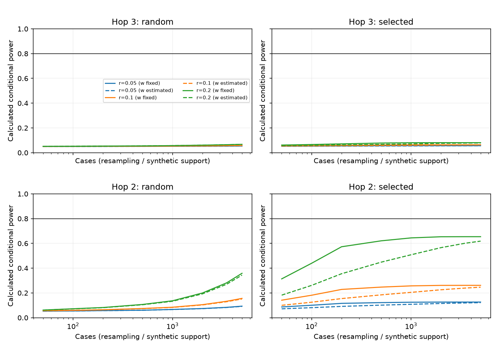

# Q1 design: how few distinct cases can identify the prompt?

## Answer for the advisor meeting

There is no data-established minimum number of DISTINCT real cases in this label-free study. The 120 cached cases and the copied host pools define limited graph support. Simulated fresh cases and repeated Gaussian outcomes are different quantities. The table reports conditional planning budgets, not an empirical identification result. The smallest simulated budget is the smallest tested grid point, not an exact integer optimum.

The cheapest numerical objective is a fixed-shape w-only pilot (D1, optionally D3 screening). A learned hop-3 decision is a separate, more demanding objective (D2/D5). Full D1 calibration is unavailable: the archives do not identify the prompt clustering/RA/hub thresholds. Use the conditional D1 numbers only if the advisor accepts these engineering restrictions. D3+D4 is a candidate only if a common discount is substantively acceptable; the unequal .59/.19 calibration anchors do not justify that equality. An intraday article pilot has many more partner rows but not 1.5 million news-matched independent articles; the clean model window is smaller still.

For the advisor: the smallest tested conditional MAE .10 budget is D1+D3 at r=.20, n=50; r=.05/.10 need n=500. That design learns only w and its oracle screen contains 1,667 article IDs (314 selected IDs at n=50). If screening fields are unavailable, prefer the unscreened w-only pilot (n=200 at r=.20, precision .10) as a simpler first study. No claimed small budget learns the original graph shape from returns. These are planning choices; neither r nor correct shape is established without labels.

## Registered protocol and interpretation

Protocol: `D:\OptResearch_data\agent_q1\run_v2_design\PROTOCOL_DESIGN.json`; SHA-256 `84c54007103be9ce17bab07f2a4ff297bed929d8ddd0a507faa9118219616817`. Registered UTC: 2026-10-27T00:39:16.993406+00:00. No simulations preceded registration. Seeds, starts, grids, model windows, noise, selection, criteria and information approximations were fixed there. Implementation hashes were frozen before simulation in IMPLEMENTATION_FREEZE.json. Follow-up study: earlier published aggregate results were known.

A supplemental protocol `D:\OptResearch_data\agent_q1\run_v2_design\PROTOCOL_DESIGN_SUPPLEMENT.json` was saved after the original daily fits, before any D6 fit or supplementary decision simulation. It adds unknown-w tests, requires exact conditional power as well as 8/10 simulated rejections, and adds a comparable common-r intraday scenario. The original daily result artifact is preserved. A pandas `asof` attribute collision was corrected before any D6 results; implementation revisions are recorded without overwriting the first freeze.

A final protected-source check found that the shipped hop-3 default is .05, whereas the V2 recovery truth is .50. PROTOCOL_DESIGN_DEFAULT_TEST.json registered this correction before the new decision simulations. Primary D2 and D6 hop-3 tests now use .05; the earlier .50 decision results are retained in the before_default_correction JSON files. Estimation designs still use the originally registered interior V2 .50 truth. These two scientific questions must not be conflated.

Five L-BFGS-B starts; at least 8/10 replications must have all-coordinate range <=.05; each parameter MAE over ten training-best fits <=.10 or .20. No intercept, regularization or negative w. D2 uses a one-sided Gaussian score test at alpha=.05 with both conditional calculated power and the ten-replication rejection share >=.8; unknown-w sensitivity projects the alternative contrast orthogonal to the null scale regressor. Tests are separate; joint testing of both hops needs multiplicity correction. All fit records and exact analytic power curves are retained. Daily planted midpoint is .5 in all four coordinates. D1 plants the mapped hop weights and w=.5, fixing all other coordinates.

## Summary: planning minimum distinct fresh-case equivalents

| Design / target | r=.05 | r=.10 | r=.20 |
|---|---:|---:|---:|
| D0 / 0.10 | A 1,010,273 | A 250,670 | A 60,769 |
| D0 / 0.20 | A 252,569 | A 62,668 | A 15,193 |
| D1_conditional / 0.10 | S 2,000 | S 2,000 | S 200 |
| D1_conditional / 0.20 | S 1,000 | S 200 | S 100 |
| D3_expanded_random / 0.10 | A 927,952 | A 230,244 | A 55,817 |
| D3_expanded_random / 0.20 | A 231,988 | A 57,561 | A 13,955 |
| D3 / 0.10 | A 414,117 | A 102,751 | A 24,910 |
| D3 / 0.20 | A 103,530 | A 25,688 | S 5,000 |
| D3_host_only / 0.10 | A 662,187 | A 164,302 | A 39,831 |
| D3_host_only / 0.20 | A 165,547 | A 41,076 | A 9,958 |
| D4 / 0.10 | A 1,008,380 | A 250,200 | A 60,655 |
| D4 / 0.20 | A 252,095 | A 62,550 | A 15,164 |
| D3+D4 / 0.10 | A 411,718 | A 102,156 | A 24,765 |
| D3+D4 / 0.20 | A 102,930 | A 25,539 | S 2,000 |
| D1+D3_conditional / 0.10 | S 500 | S 500 | S 50 |
| D1+D3_conditional / 0.20 | S 200 | S 50 | S 50 |
| D5_hop3_w / 0.10 | A 247,544 | A 61,421 | A 14,890 |
| D5_hop3_w / 0.20 | A 61,886 | A 15,356 | S 500 |
| D2 hop-3 power .8 | A 22,666,951 | A 5,624,131 | A 1,363,426 |
| D2 hop-2 power .8 | A 311,670 | A 77,332 | A 18,748 |
| D2_w_nuisance hop-3 power .8 | A 23,190,819 | A 5,754,113 | A 1,394,937 |
| D2_w_nuisance hop-2 power .8 | A 331,996 | A 82,375 | A 19,970 |
| D5_thresholds+D2+selection hop-3 power .8 | A 8,557,013 | A 2,123,169 | A 514,708 |
| D5_thresholds+D2+selection hop-2 power .8 | A 123,346 | A 30,605 | A 7,420 |
| D5_thresholds+D2+selection_w_nuisance hop-3 power .8 | A 9,712,434 | A 2,409,853 | A 584,207 |
| D5_thresholds+D2+selection_w_nuisance hop-2 power .8 | A 135,751 | A 33,683 | A 8,166 |
| D6_reduced_common_r / 0.1 | A 19,831 | A 5,001 | S 5,000 |
| D6_reduced_common_r / 0.2 | A 5,001 | S 5,000 | S 500 |
| D6_all_graph_common_r / 0.1 | A 144,068 | A 35,746 | A 8,666 |
| D6_all_graph_common_r / 0.2 | A 36,017 | A 8,937 | A 2,167 |
| D6_calibrated_w_common_r / 0.1 | A 257 | A 64 | A 16 |
| D6_calibrated_w_common_r / 0.2 | A 65 | A 16 | A 4 |
| D6_hop3_test_common_r / power .8 | A 71,575 | A 17,760 | S 5,000 |

**S** = smallest passing registered grid point through 5000 (10 replications). **A** = local expected-MAE/power approximation; five-start agreement is not certified beyond 5000. An A value <=5000 that did not pass is conservatively displayed as >5000 (5001); exact local values remain in JSON. Baseline simulations resample the 120-case bank, so S n>120 is an independent-noise draw count and only a projected fresh-case equivalent. Expanded candidates are sampled without replacement but resampled field draws do not create observed new articles/cases. The primary D6 common-r rows set the same signal-return correlation as daily rows by changing simulated noise. This requires lower residual noise than the raw archive and is a hypothetical efficiency scenario. Original archive-anchored transfer attenuation is retained separately below.

Local formula: sigma^2 inverse(E[J J^T]); expected MAE = sqrt(2/pi) SE. Take the largest coordinate requirement. A singular matrix is unidentified, never silently pseudo-inverted. This is an expected-MAE calculation, not an 80% probability that all coordinates lie within the target. Optimization agreement and statistical accuracy are distinct. Sample sizes need not be monotone with only ten replications.

## D1: documented intraday-to-prompt mapping

| Quantity | Estimate | Uncertainty | Mapping / limitation |
|---|---:|---:|---|
| hop2/direct | 0.59178 | 0.0780876 | L1 delta SE bound; historical ratio, not an exact transport SE |
| distance3/direct | 0.187639 | 0.0353765 | L1 delta SE bound; historical ratio, not an exact transport SE |
| M3 RA | 0.0182097 | 0.00995444 | week-cluster SE = abs(estimate/t_week) |
| M3 log responder degree | -0.00360107 | 0.000278515 | week-cluster SE = abs(estimate/t_week) |
| balanced linked premium | 0.0396008 | 0.000858231 | week-cluster SE = abs(estimate/t_week) |

Hop 1 is normalized to one. Hop 2 is the equal average of historical L_cocust/L_cosup/L_cust2/L_sup2 divided by the supplier/customer average; hop 3 uses the exact-distance-three d3 single-regressor coefficient divided by that direct average. These are different-support partial regressions, so the ratios are planning anchors. They are not causal attenuation estimates. p3 is log walk count, not an exact hop-3 indicator. Unknown covariance is handled with a conservative L1 delta SE bound; structural transport uncertainty is additional and unmeasured. Negative reference-state M3 L coefficients are not reinterpreted as negative unconditional linked premia.

RA has positive single-feature gradients but a weak reference-state effect in the interaction-rich M3 horse race. The single-feature RA slope is 0.326211 (SE 0.0310024); the M3 RA slope is 0.0182097 (SE 0.00995444). A slope does not identify a logistic threshold, or its fixed 25% amplitude. The negative log-degree gradient supports hub damping direction, but neither the 50% amplitude nor a degree-percentile threshold is estimated. No local clustering gate estimate was found; `sc` in GRAPHTOOLS means shared customers. Hub, RA, clustering and materiality q=.5 are engineering choices with SE **unavailable**, not zero. Thus strict D1 (all shape empirically known) has **no identified sample-size answer**. The conditional D1 rows expose the assumption.

O5 puts positive weights on few partners, RA-top and shared2, but they are ridge exposure-ranking weights with no archived sampling SE. Its raw motif-specific RA cutoffs are not the prompt RA-percentile threshold. G2 selected gamma=.5 for supplier/customer/co-customer and 1 for co-supplier; coverage controls and held-out rankings weaken a universal specialization calibration. Weekly co-customer checks use only the 2021-22 aggregate window: {"base": {"real": 0.025018955468065984, "placebo_mean": 0.023754542854175952, "network_specific": 0.001264412613890032, "p": 0.09090909090909091}, "ra_cc": {"real": 0.021732572393757144, "placebo_mean": 0.021298419530659318, "network_specific": 0.000434152863097826, "p": 0.36363636363636365}, "spec_cc": {"real": 0.0026376732367163758, "placebo_mean": 0.003099737515513312, "network_specific": -0.00046206427879693637, "p": 0.9090909090909091}, "gen_cc": {"real": 0.028888342269300815, "placebo_mean": 0.026879471097690046, "network_specific": 0.0020088711716107696, "p": 0.09090909090909091}, "ra_cs": {"real": 0.01283795053591752, "placebo_mean": 0.012413644948733982, "network_specific": 0.0004243055871835377, "p": 0.36363636363636365}, "ra_all": {"real": 0.028228163264948702, "placebo_mean": 0.02625184380092189, "network_specific": 0.0019763194640268107, "p": 0.18181818181818182}, "ra_cc_sum": {"real": 0.010858426408828392, "placebo_mean": 0.009776743150004263, "network_specific": 0.0010816832588241287, "p": 0.09090909090909091}}. The graph-rewire rank p values quantify a different uncertainty from an estimation SE; none is fabricated. Full source paths/hashes and numerical rows are in calibration.json.

### Miscalibration cost

At n=5000, perturb each calibrated hop by plus/minus its SE bound and refit w with five starts. Also stress each unidentified threshold q by plus/minus .20; this is **not** an SE perturbation. The probability-limit w is clip(E[s_cal*s_true]/E[s_cal^2],0,1); persistent bias does not vanish with n.

| Perturbation | Pseudo-true w | Bias | MAE at r=.05/.10/.20 |
|---|---:|---:|---|
| correct | 0.50000 | +0.00000 | 0.0472 / 0.0554 / 0.0169 |
| lambda2_-1SE_bound | 0.50154 | +0.00154 | 0.0553 / 0.0541 / 0.0173 |
| lambda2_+1SE_bound | 0.49838 | -0.00162 | 0.0845 / 0.0312 / 0.0226 |
| lambda3_-1SE_bound | 0.50046 | +0.00046 | 0.1249 / 0.0509 / 0.0224 |
| lambda3_+1SE_bound | 0.49952 | -0.00048 | 0.0874 / 0.0520 / 0.0191 |
| hub_-10.2_STRESS_no_SE | 0.50649 | +0.00649 | 0.0778 / 0.0362 / 0.0208 |
| hub_+10.2_STRESS_no_SE | 0.49835 | -0.00165 | 0.0596 / 0.0344 / 0.0280 |
| RA_-10.2_STRESS_no_SE | 0.49646 | -0.00354 | 0.0479 / 0.0271 / 0.0158 |
| RA_+10.2_STRESS_no_SE | 0.50174 | +0.00174 | 0.0719 / 0.0298 / 0.0214 |
| clustering_-10.2_STRESS_no_SE | 0.50416 | +0.00416 | 0.0499 / 0.0338 / 0.0266 |
| clustering_+10.2_STRESS_no_SE | 0.49345 | -0.00655 | 0.0749 / 0.0540 / 0.0142 |

## D3, D4 and D5: case selection and parameter restrictions

Copy compact host hop/degree-percentile/RA-percentile/clustering fields from the 120 ten-ticker cases and six three-hop pools; the active hop3_run files are never modified. The exact copied-byte hashes are in host_templates.json. The June 2025 graph is held constant by the original study assumption, without a certified acquisition vintage. For each synthetic candidate, keep up to two direct rows and sample up to six neighbour rows from a single host template. Draw each complete (relevance,direction,materiality) tuple from its exact-hop empirical distribution in the 120 cache. The tuple keeps internal dependence; cross-article, cross-target, event-direction dependence and association with graph features are not identified and are omitted. This is an optimistic model for screening, not generated LLM evidence. It preserves zeros and hop-specific sparsity.

D-optimal greedy selection maximizes log-determinant increments of J^TJ at the prior in named unit-box coordinates. A tiny design-only ridge seeds the first pivots; no fit penalty. Selected cases are never repeated within the 5000 ordering. Noise SD is calibrated to the unselected population and kept unchanged after selection. D3 sees imputed LLM fields, so it requires a screening pass before real selection; its full candidate article-call cost can dominate the final selected n. Expanded-random local benchmarks isolate selection benefit from the new support (daily_results.json). The support-matched random control and a host-only selector are both simulated. The host-only selector uses template-average expected Jacobian second moments, and never the individual candidate imputation. It remains dependent on the imputation distribution. Finite candidate depletion matters: the reported D3 local approximation uses its 5000 selected rows and cannot be repeated indefinitely without fresh comparable support.

D4 merges the two hop weights; its Jacobian is J_hop2+J_hop3. This increases information only under the equality restriction. If true hop discounts differ, the single fitted discount is a projection and does not recover both. D5 additionally fixes thresholds and tests hop3, and tests a selected hop3+w fit. Test-optimal selection ranks the exact alternative-minus-null contrast; it is distinct from D-optimal joint estimation. The D2 nuisance-fixed test is cheaper than estimating every parameter, but its conclusion depends on the fixed shape and w.

### Selection benefit and actual article-call accounting

At MAE .10 and r=.20, expanded-random local n is 55,817, D3 is 24,910 (2.24 times fewer), and host-only selection is 39,831 (1.40 times fewer). D3+D4 local n is 24,765: merging barely improves the clustering bottleneck. Its earlier .20 grid pass is a coarse Monte Carlo result, not a robust 2.5-fold information gain.

The full 12,000-candidate screen contains 1,667 distinct article IDs. The cached 120 cases contain 486; reusing their fields costs zero new calls. An oracle D3 screen would need partner-specific article fields for the full candidate screen; host-only selection can score just the final selected articles. For future independent cases, article overlap is unknown, so eight articles per case is only a call upper bound. Repeated article IDs do not create fresh cases.

| Selected conditional w-only design, MAE .10 | Cases | Distinct selected article IDs | Full screening calls |
|---|---:|---:|---:|
| r=0.05 | 500 | 1,122 | 1,667 |
| r=0.1 | 500 | 1,122 | 1,667 |
| r=0.2 | 50 | 314 | 1,667 |

Exact source-ID replay and every daily-design budget are in call_budgets.json. D2/D5 projected fresh-case budgets have at most 8*n text calls, plus any candidate-screen calls; no exact future article count can be inferred.

### D2 power curves through n=5000

The curves show calculated conditional power. Dashed curves estimate w as a nuisance; solid curves fix w. A passing decision cell also requires at least eight simulated rejections in ten. No daily test meets both requirements by n=5000.

## D6: intraday article design and available clean events

The regression is y_ers = alpha_set + beta_sign*controls + w*[relevance*direction*materiality]_article,partner*L_ers*hop_discount*gates. Use unsigned same-bin returns, separate up/down regressions, and average their directional coefficients with equal sign weight. After set fixed effects, one linked plus three placebos yields a linked-minus-placebo-mean score contrast and noise variance 4/3 in responder-sigma units. No outcome or new content label is loaded here. O2 timestamp/candidate-RIC metadata and N1 RIC mapping are reused; N2 event keys supply announcer jumps. Count articles in [bin start-30 minutes, bin end), then assign the earliest eligible article. Strictly pre-bin events are shown separately; within-bin text is contemporaneous explanatory information and cannot be called a pre-jump forecast. Bin-end equality is excluded. An any-prior-same-day sensitivity is in the count artifact. Original news_bins/news_days only span a shorter archive and are crosschecks, not decade-wide counts.

| Year | Announcer jumps | Reuters matched | Strict pre-bin | Distinct chosen articles | Hop1 rows | Hop2 rows | Hop3 rows |
|---|---:|---:|---:|---:|---:|---:|---:|
| 2015 | 160,654 | 778 | 581 | 749 | 3,623 | 9,598 | 3,573 |
| 2016 | 159,664 | 773 | 531 | 750 | 3,091 | 8,614 | 3,366 |
| 2017 | 160,608 | 723 | 500 | 704 | 2,907 | 8,065 | 3,138 |
| 2018 | 159,035 | 790 | 552 | 770 | 3,051 | 8,573 | 3,441 |
| 2019 | 152,914 | 825 | 569 | 806 | 3,276 | 8,934 | 3,508 |
| 2020 | 151,460 | 845 | 594 | 830 | 3,054 | 9,036 | 3,634 |
| 2021 | 113,198 | 873 | 621 | 855 | 3,471 | 9,937 | 3,931 |
| 2022 | 139,641 | 830 | 680 | 814 | 3,329 | 9,321 | 3,658 |
| 2023 | 153,312 | 1,057 | 853 | 1,039 | 3,832 | 11,312 | 4,493 |
| 2024 | 156,933 | 1,058 | 830 | 1,032 | 4,348 | 11,949 | 4,411 |

Complete O3 partner support: 8,468 matched events, 166,474 rows and 8,268 distinct articles. Jul-Dec 2024: {"events": 517, "rows": 10216, "articles": 502, "partners_by_hop": {"1": 2152, "2": 5923, "3": 2141}, "transition_shares": {"hub": 0.42384494909945186, "RA": 0.581636648394675, "clustering": 0.5173257635082223}}.

Before requiring complete partners, the decade contains 8,552 recent Reuters-matched jumps; Jul-Dec 2024 contains 520 such jumps and 505 selected articles. The clean-window model table below uses the smaller complete-partner support.

Graph transition shares (sigmoid between .1 and .9) at the V2 prior are {"hub": 0.4007292430049137, "RA": 0.5905066256592622, "clustering": 0.5480435383303098}. Year-specific shares are in intraday_counts.json. Materiality has no observed label-free transition count; its share is imputation-dependent. Graph degree and clustering belong to the focal responder; RA is symmetric pair exposure and percentile uses the month graph universe. Shortest distance is recomputed on the month-before undirected graph; walks and directed path labels are not substituted. Matching uses the existing O3 complete-partner cache, which imposes additional sampling/exclusion rules and cannot count all conceivable linked firms.

| Candidate model | Clean events with partners | Distinct article calls |
|---|---:|---:|
| gpt-oss-20b | 517 | 502 |
| Qwen3.8-27B | 0 | 0 |
| frozen Claude Sonnet 4.5 | 0 | 0 |
| frozen Claude Opus 4.6 | 0 | 0 |

Cutoffs are the user-specified planning assumptions: gpt-oss-20b clean from July 2024; Qwen3.8-27B has no clean window here; frozen Sonnet 4.5/Opus 4.6 clean from Aug/Sep 2025, after these data end. No online lookup or model call verified them. Every pre-cutoff event needs a no-text recall probe before using its article text. A probe is a diagnostic, not proof that memorization is absent. One prompt per distinct article can bundle all relevant partner-specific fields; one scalar shared relevance for every partner would be misspecified. Calls are counted by distinct article, never by partner row. One no-text probe per distinct pre-cutoff article is an additional call if that design is pursued. Full matched decade: 8,268 text calls, plus that many probes when entirely pre-cutoff. No calls were executed. Exact deterministic prefix costs are in intraday_information.json.

### Signal and information, with a small simulation

Archived balanced premium 0.0396008 responder-sigma units implies per-row SNR 0.0342953 with contrast noise SD 1.1547. Scale the imputed article regressor to that RMS premium; this grants correct signal shape and can overstate incremental LLM information. For common-r comparisons, required row-noise SD is {"0.05": 0.7745273189585027, "0.1": 0.3858050341099639, "0.2": 0.1899572675037111}, versus archive contrast SD 1.1547. Those are efficiency assumptions, not measured noise reductions. In the separately retained transfer scenario r=.05/.1/.2 multiplies the archive signal, and r=1 is the archive envelope. Per-event information is J_event^T Sigma_event^-1 J_event with rho=.25 within-event errors; rho=0 and .75 sensitivities are retained. Events, articles, partners and correlated calendar clusters are not interchangeable. Day/source dependence beyond event rho remains unmodeled. The six-parameter alternative also estimates hub and RA thresholds, with materiality fixed; the four-parameter alternative matches Q1d.

The RA and degree comparisons are {"RA_SD": 0.2030455981461012, "M3_RA_effect_per_observed_SD": 0.0036973967030260223, "M3_RA_SE_per_observed_SD": 0.002021204576519453, "prompt_RMS_J_RA": 0.005516989279272083, "M3_logdegree_slope": {"estimate": -0.003601067170430939, "SE": 0.0002785150398911276, "t": -12.929524997424224}, "logdegree_SD": 1.1106872546432276, "M3_logdegree_effect_per_SD": -0.003999659409311795, "M3_logdegree_SE_per_SD": 0.0003093431050335255, "prompt_RMS_J_hub": 0.005643265621690821, "warning": "fixed-amplitude gates are not jointly fitted to archived gradients; RMS premium match can overstate shape information; RA percentile and raw RA have different units"}. Archive partial slopes constrain plausible effect magnitudes but cannot establish the derivative of a nonlinear threshold. RMS normalization does not calibrate all gradients simultaneously. Add pair-varying controls by FWL residualizing both score and Jacobian within sign/set before any real regression; the current information envelope assumes nuisance controls are orthogonal or constant across linked/placebos.

| Common r | Events n | Agreement | MAE hop2 / hop3 / clustering / w |
|---|---:|---:|---|
| 0.05 | 50 | 0.50 | 0.3771 / 0.4556 / 0.4042 / 0.2581 |
| 0.05 | 500 | 0.60 | 0.2225 / 0.2765 / 0.2667 / 0.0629 |
| 0.05 | 5000 | 0.70 | 0.0630 / 0.0903 / 0.3207 / 0.0358 |
| 0.1 | 50 | 0.50 | 0.2194 / 0.4002 / 0.3429 / 0.1241 |
| 0.1 | 500 | 0.90 | 0.0620 / 0.0791 / 0.2033 / 0.0319 |
| 0.1 | 5000 | 1.00 | 0.0298 / 0.0293 / 0.1281 / 0.0175 |
| 0.2 | 50 | 0.70 | 0.1126 / 0.2523 / 0.2970 / 0.0865 |
| 0.2 | 500 | 0.90 | 0.0512 / 0.0475 / 0.1892 / 0.0412 |
| 0.2 | 5000 | 1.00 | 0.0112 / 0.0171 / 0.0658 / 0.0117 |

Archive signal envelope (r_transfer=1, rho=.25) is shown in the table below. Its budgets exceed the comparable common-r assumptions.

The large event archive therefore does not automatically solve the shape problem. Clean available event counts must exceed the planned budget, and the linked premium is not the incremental effect of LLM fields conditional on existing numerical controls. If n exceeds available matched events, additional independent events/articles are required; replaying the same article does not add clean information.

### Archive-calibrated event budgets and clean-window feasibility

| Archive-signal design | Target | Local events | Article calls within current archive | Fits clean 517-event window? |
|---|---:|---:|---:|---|
| D6_reduced | 0.1 | 44,077 | unavailable; needs fresh events | False |
| D6_reduced | 0.2 | 11,020 | unavailable; needs fresh events | False |
| D6_calibrated_w | 0.1 | 570 | 570 | False |
| D6_calibrated_w | 0.2 | 143 | 143 | True |
| D6_hop3_w | 0.1 | 5,208 | 5137 | False |
| D6_hop3_w | 0.2 | 1,302 | 1299 | False |
| D6_hop3_test | power .8 | 179,273 | unavailable; needs fresh events | False |

The archive-calibrated shape requirement is about 44,077 events at MAE .10 and 11,020 at .20, exceeding the 8,468 matched-event archive. The fixed-shape hop-3 test at the shipped .05 default needs about 179,273 events, exceeding both the full matched archive and the clean 517-event window. A w-only pilot at precision .20 needs about 143 events under this envelope and fits the clean window; .10 needs about 570 and exceeds it. These are local approximations, with nuisance shape assumed correct.

The archived week-cluster SE implies an additional variance sensitivity: {"event_variance_from_week_SE": 1.1103056692050062, "nominal_event_variance": 0.3958276328836321, "multiply_local_n_by": 2.805023138774702, "note": "Calendar/source dependence and unequal row weights may enter this ratio; not an identified within-event correlation"}. Multiplying local sample sizes by this factor is a conservative calendar/source-dependence diagnostic. It is not an identified event correlation.

Materiality transition share in the imputed article rows is 0.8668; this is simulated, while the other three gate shares above use observed host fields. Hop weights and w have no transition gate.

| Common-r hop-3 test | Minimum tested events | Calculated power at that n | Simulated power |
|---|---:|---:|---:|
| 0.05 | none through 5000 | NA | NA |
| 0.1 | none through 5000 | NA | NA |
| 0.2 | 5000 | 0.848 | 0.90 |

Intraday small simulations used n=50,500,5000 for the four-parameter model; optional six-parameter/w-only rows are information calculations only. The D6 power experiment and its .05-default correction were separately registered after the primary fits. The common-r .20 shape design needs 5,000 events at precision .10 (about 4,935 calls in the deterministic archive prefix), which exceeds the clean window. A .20 precision target passes at 500 events, but its r=.20 requires roughly six times lower residual noise SD than the raw archive. The earlier .50 hop-3 archive test required about 1,793 events; reducing the alternative to the shipped .05 multiplies that local budget by 100 at fixed noise.

## Limitations

The simulation minima are conditional on a correctly specified smooth surrogate, independent daily Gaussian noise, the planted truth and limited host support. No labels means no empirical incremental LLM-signal estimate or validation of transfer r. Ten replications produce unstable grid minima; a second validation batch and denser predeclared grid are needed before budgeting a production run. Local Gaussian approximations ignore boundaries, nonlinear likelihood shape and optimizer failure. Fixed shape shifts uncertainty into assumptions. Optimal selection changes the target case distribution; extrapolation to the random target population requires separate evaluation. The D3 candidate screen itself may require many calls. The study cannot prove a universal minimum, global optimality, causal propagation or contamination freedom.

## Possible errors and checks performed

- Analytic score/Jacobian finite-difference maximum absolute error 1.11e-11. Exact equivalence to V2 and merged Jacobian tested.
- Tests cover the information formula/singular rejection, greedy selection/no replacement, null-vs-alternative test power, fixed-noise selection, immutable preregistration, strict bin-end matching, metadata allowlist, 2025 guard and clustered GLS algebra.
- Graph asof dates are checked before event month; timestamp/years bounded to 2015-24. No intraday 2025 rows or returns were opened. Sign balance and available clean-window counts are explicit.
- Ratio SEs are conservative bounds without covariance, not fabricated exact SEs; unavailable clustering/threshold/weekly SEs remain unavailable. Shared customers are not clustering.
- Distinct observed host IDs, synthetic feature banks, independent outcome draws, articles and partner rows are recorded separately. Resampling never creates observed distinct cases.
- Registration hash, protected-source hashes and cached input hashes checked after simulation. No label-loading helper is called. Metadata column projections exclude content labels and return outcomes. No package install, process termination, external write or network/LLM call.
- Peak process memory: 1588.3 MiB, below 2 GiB. Serial fits, one native BLAS thread. Existing unrelated changes preserved; .git untouched.
- All fit diagnostics distinguish solver success, coordinate agreement and recovery. A relative-loss stop is not a projected-gradient proof. All S/A labels expose where no nonlinear simulation passed.

- The original memory API returned zero because of an incorrect 64-bit handle signature. This was fixed, failure now raises, a positive-memory unit test was added, and the full intraday simulations were replayed under the working guard. An optional later host-snapshot memory replay stopped when the other job moved a pool file; the original copied host metadata was retained and all design results use that saved copy.

## Files and reproduction

New repository files: `source/code/news_network_50_2025/prompt_gd_design.py`, `examples/test_q1_design.py`, `docs/Q1_DESIGN_REPORT.md`, `docs/Q1_DESIGN_power.png`. Changes left uncommitted. Run with the supplied interpreter: `python -m source.code.news_network_50_2025.prompt_gd_design register`, then `... run`. Tests: `python -m unittest examples.test_q1_design`. All data artifacts under `D:/OptResearch_data/agent_q1/run_v2_design/`.

Set `$env:Q1_SEAL_DATE="2025-11-03"` in PowerShell before running the study, and use `C:/OptResearch/.venv_dspy/Scripts/python.exe` for each command. Raw 2025 intraday inputs are never needed. Saved compact host snapshots allow replay even if the active hop-3 job moves its files.

Report copy: `C:\OptResearch\results\sc_risk\agent_q1\Q1_DESIGN_REPORT.md`.
