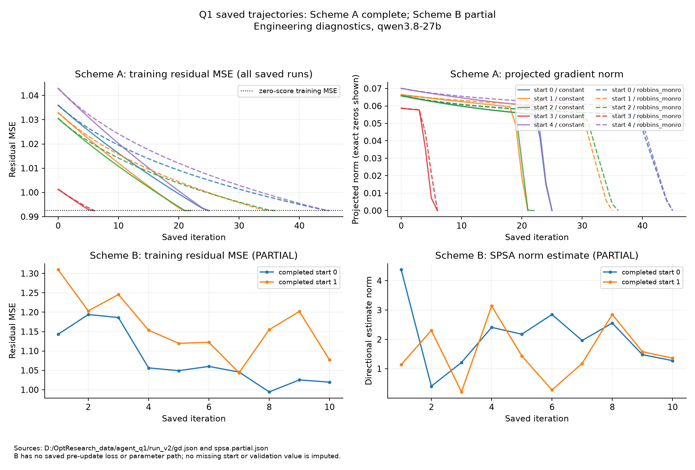

# Q1: graph skills and prompt-parameter convergence

Model for the saved diagnostics: **qwen3.8-27b**, engineering only. It is not look-ahead clean for the historical dates. Scheme B remains partial. The user decided not to restart the local model.

## Verdict

The graph tools and optimizer machinery are implemented and tested. Scheme A converges to **w = 0 in all 10 runs**, with **80 train / 40 validation cases**, training MSE **0.9925**, and validation MSE **1.5259**, exactly the zero-score baseline. The other **6 directions** are flat at that boundary solution. Full-vector agreement is false. Source: `D:/OptResearch_data/agent_q1/run_v2/gd.json`.

Under the studied return-label designs, prompt graph parameters are not identifiable at feasible sample sizes. Only the score scale is practically recoverable with fixed shape and sufficient signal. Fix graph parameters from the numerical intraday and weekly studies. Declare any unestimated thresholds as engineering restrictions. The real-data scale adds no score. No predictive or causal success is established.

## Implementation and skill invocations

Commit `6b18d7f` implements directed degree and monthly percentiles; undirected triangles and clustering; pair shared partners and RA; standalone scripts; toolkit/MCP registration; host recomputation; and context-selection integration. Its recorded **85 tests** comprise **57** example, **25** design, and **3** validator tests. Sources: `D:/OptResearch_data/agent_q1/examples_final_tests.log`, `design_final_tests.log`, and `skill_validator_tests_final_tests.log` in that directory. Later identification/design modules and tests remain uncommitted.

The advisor's invocation format is task + inputs + script + constraints + deliverable + stop. Numerical defaults and path limits come from `D:/OptResearch_data/external/supply-chain-news-risk/skills/sc-graph-degree/SKILL.md` and `D:/OptResearch_data/external/supply-chain-news-risk/skills/sc-graph-triangles/SKILL.md`.

```text
/sc-graph-degree compute target degree; inputs: firm_id, cutoff, dated snapshot, monthly_universe, max_hops, inspected_prefixes; script: skills/sc-graph-degree/scripts/graph_degree.py; constraints: pre-cutoff edges, max_hops <= 3, exact inspected prefixes, THRESH_HUB=90; deliverable: verified JSON and receipt; stop on success or report coverage/error.
/sc-graph-triangles compute target/pair motifs; inputs: firm_id, neighbour, cutoff, dated snapshot, monthly_universe, max_hops, inspected_prefixes; script: skills/sc-graph-triangles/scripts/graph_triangles.py; constraints: pre-cutoff edges, max_hops <= 3, exact inspected prefixes, THRESH_RA=75, THRESH_CLUST=0.5; deliverable: verified JSON and receipt; stop on success or report coverage/error.
```

The host excludes expired/future edges, duplicates, and self loops. It recomputes model-written statistics. Reciprocal partners enter both directed degrees. RA uses unique undirected degrees and a positive-exposure guard. Truncation means incomplete coverage. Topology does not establish product continuity.

## Data discipline and local provenance

The final panel replaces the August-only pilot: **80 August-September train / 40 October validation cases**, with evaluation from **2025-11-03** sealed. Scheme B uses **20 training cases**, with **40 validation cases planned**. Sources: `D:/OptResearch_data/agent_q1/data_v2/development_manifest.json` and `D:/OptResearch_data/agent_q1/run_v2/PROTOCOL.json`. The anchor and held-fixed graph membership remain engineering assumptions; this is not a replication of the expanded collaborator regression.

## Parameterization and predeclared convergence tests

`prompt_gd.py` supplies exact projected gradients for the cached surrogate and SPSA for model-read prompt parameters. It distinguishes loss stability, projected stationarity, full-vector agreement, a training-selected grid comparison, and validation improvement. The evidence budget is fixed. The historical cached LLM ratings are diagnostic inputs only; the user has rejected them as future regression variables.

### Scheme A: exact gradients of a cached-feature surrogate

All **10 runs** reach the zero-score boundary and satisfy the projected-gradient stop. Agreement of the full parameter vector fails. The **2,187-point** grid omits **w = 0** and has higher training MSE (**0.997306**); its validation MSE (**1.525278**) does not change the training-selected conclusion. Source: `D:/OptResearch_data/agent_q1/run_v2/gd.json`.

### Scheme B: thresholds inside the local-model prompt (PARTIAL)

Only **2 of 3 starts** completed, each with **10 iterations**. Final w values are **0.205840** and **0.304617**. First saved to final training losses are **1.143020 to 1.019592** and **1.309725 to 1.077037**. Both stopped at the cap. The first loss is post-update. Sources: `D:/OptResearch_data/agent_q1/run_v2/spsa.partial.json` and `D:/OptResearch_data/agent_q1/run_v2/PROTOCOL.json`.

The remaining start did not complete. The **2x2 grid**, validation scoring, and end-to-end smoke did not run. The local llama-server failed with CUDA out-of-memory at approximately **21:01 America/New_York on 2026-10-26** during SPSA. Sources: `C:/OptResearch/data/qwen/server.log` (end and failure-time file timestamp), `D:/OptResearch_data/agent_q1/spsa_v2.stderr.log`, and `D:/OptResearch_data/agent_q1/run_v2/PROTOCOL.json`. Convergence and validation improvement are not established. No restart is planned.

### Identification and design findings

| Study | Result | Meaning and source |
|---|---|---|
| VP, MAP, planted recovery | Recovery fails through **n = 2,000**. | Regularization supplies prior curvature, not identification. [Identification report](Q1_IDENTIFY_REPORT.md). |
| Reparameterization and L-BFGS-B | Conditioning **139,083 to 431**; required-cell agreement **80-90%**, but largest shape MAE per cell **0.25-0.46**. | Numerical agreement improves; shape recovery fails. [Identification V2 report](Q1_IDENTIFY_V2_REPORT.md). |
| Daily design | At expected MAE **0.10**, baseline joint-shape budgets are about **60,000-1,000,000 cases**; conditional fixed-shape w-only minima are **50-2,000**. | Local approximations versus simulated grid minima; no universal real-case minimum. [Design report](Q1_DESIGN_REPORT.md). |
| Daily hop test | Null hop-3 weight **0**, default alternative **0.05**: over **1 million cases** in the baseline design. | Conditional power requirement, not a measured absence of effect. [Design report](Q1_DESIGN_REPORT.md). |



Sources: `D:/OptResearch_data/agent_q1/run_v2/gd.json` and `D:/OptResearch_data/agent_q1/run_v2/spsa.partial.json`. Scheme A shows the projected norm; Scheme B shows an SPSA estimate. No missing data are imputed.

## Part-3 smoke

The local-model smoke did not run. The separate PR #2 H1/H2/H3 ablation is **running on real data with deepseek-v4-pro**. Final results are pending at `C:/OptResearch/results/sc_risk/agent_q1/HOP3_ABLATION_REPORT.md`; its earlier pending preparation text is not a DeepSeek result.

## Execution, resources, and reproduction

The standard convergence-report function requires completed SPSA fields. The saved-file figure builder is `C:/OptResearch/results/sc_risk/agent_q1/build_q1_trajectories_20261026.py`. It uses no labels, models, or network. The complete final narrative is `C:/OptResearch/results/sc_risk/agent_q1/Q1_REPORT.md`.

## Decisions and limitations

The user's October 26 decisions apply. Subjective LLM relevance, direction, and materiality ratings will not enter regressions. Graph parameters come from numerical intraday/weekly regressions. The LLM proposes interpretable mechanisms for deterministic acceptance or rejection. DeepSeek is approved for engineering, including Reuters text. It is used for O4 proposer rounds and the hop ablation; the O4 v4 tool-using agent is being finalized.

Numerical slopes do not identify every prompt threshold or amplitude. Fixed thresholds require declared assumptions and sensitivity checks. Simulated sample sizes depend on correct shape, signal, selection, and noise. Repeated cached evidence is not fresh graph support. Endpoint flatness limits solver certificates. The model is a historical contamination risk. Partial SPSA supplies no validation evidence.

## Possible errors and checks performed

Saved counts, scales, stopping reasons, baseline equality, and missing SPSA outputs were checked. The terminal CUDA error and SPSA traceback agree. The figure builder verifies unchanged input hashes; the figure was visually inspected. Prior reports document gradient, graph, sufficient-statistic, registration, and leakage checks. These recorded checks are distinguished from new model execution. Each rewritten document was backed up as `.bak_20261026`. Finalization made no model or network call and preserved unrelated changes.

## Local commit status

Commit `6b18d7f` contains the graph/optimizer implementation. `prompt_gd_identify.py`, `prompt_gd_identify_v2.py`, `prompt_gd_design.py`, their tests, and the current documentation changes remain uncommitted. No commit or push was attempted.
