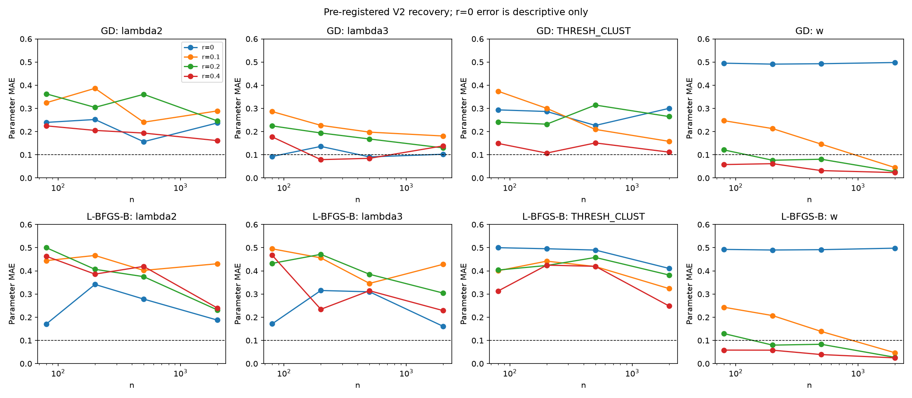
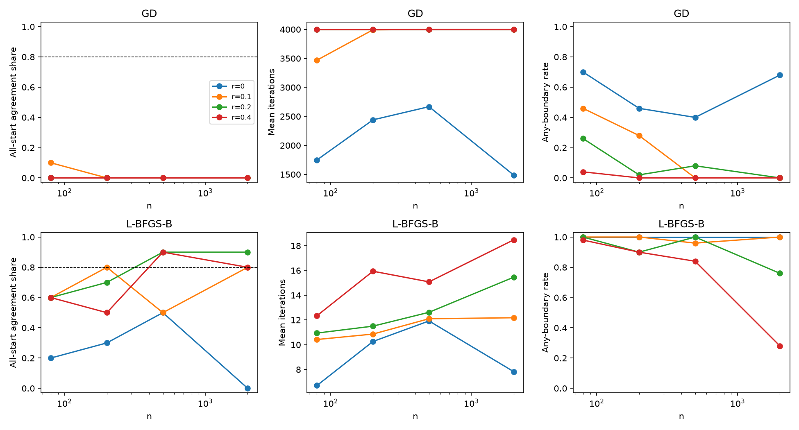
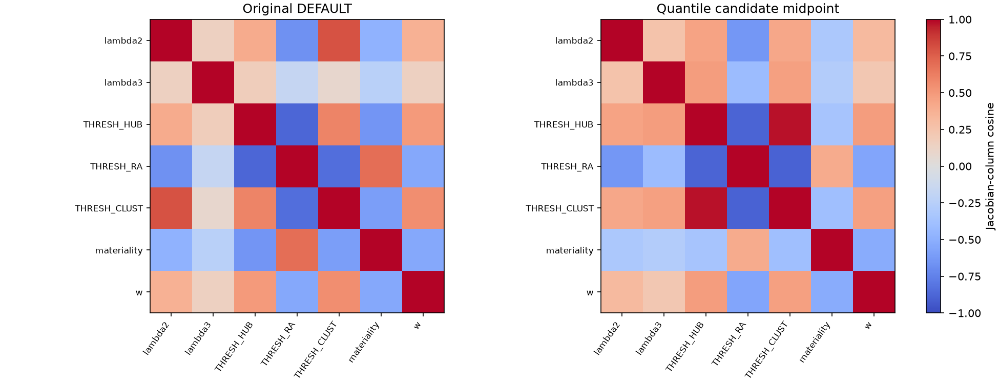

# Q1 identification V2: registered evidence correction and recovery gate

## Verdict

**Convergent with signal under the requested joint criterion: {'GD': False, 'L-BFGS-B': False}.**
The criterion is at least 80% five-start agreement (every coordinate range <=0.05) and every parameter MAE <=0.10 in EACH of r={0.2,0.4}, n={500,2000}. Optimization agreement and statistical parameter recovery are reported separately. A positive predictive gain does not establish parameter recovery.

## Registration and evidence-only design

Registered at 2026-10-26T23:35:04.566167+00:00; protocol `D:\OptResearch_data\agent_q1\run_v2_identify_v2\PROTOCOL_IDENTIFY_V2.json`. Protocol SHA-256 `5b9ec41be5f8715345798f471f4f3547f7032aec5543c2c5c186a073c3a4b5c0`. Source and dependency hashes, exact quantile coefficients, starts, seeds, screens, stopping rules and branch decision are in that immutable artifact. Registration preceded all new synthetic fits and label access. The prior report was read first and its aggregate real-data outcomes were already known. No new label file was used for parameterization or method selection. This is not a fresh, untouched validation study.

The cached bank has 120 development cases (80 train / 40 valid), 929 used rows, eight rows maximum per case, and seal 2025-11-03. Hop row counts: {'0': 212, '1': 240, '2': 239, '3': 238}; nonzero signed contribution counts: {'0': 136, '1': 82, '2': 60, '3': 53}. Quantile maps use all used neighbour rows, including zero-contribution rows. Validation covariates enter this label-free design, so the experiment is transductive with respect to the 120-case bank.

## Per-parameter diagnosis

Here s denotes the FINAL residual prediction including w; ds/dtheta uses normalized coordinates. RMS sensitivities summarize all 120 case derivatives, not just positive contributions. Transition means sigmoid in [0.1,0.9], among all used neighbour rows. Hop weights and w have no gate (N/A). Mean signed and maximum absolute derivatives and the q=0.2/0.5/0.8 sensitivity sweep are in evidence_diagnosis.json.

| Parameter | Original transition share | Original RMS ds/dtheta | Remapped transition share | Remapped RMS ds/dtheta | Decision |
|---|---:|---:|---:|---:|---|
| lambda2 | N/A | 0.00647469 | N/A | 0.00444834 | retain: active, independent under screen |
| lambda3 | N/A | 0.00611179 | N/A | 0.00521613 | retain: active, independent under screen |
| THRESH_HUB | 0.899582 | 0.00703447 | 0.799163 | 0.00241653 | fix q=0.5: collinear with THRESH_CLUST (absolute cosine >=0.8) |
| THRESH_RA | 0.396095 | 0.000903161 | 0.778243 | 0.00182798 | fix q=0.5: collinear with THRESH_CLUST (absolute cosine >=0.8) |
| THRESH_CLUST | 0 | 0.000816581 | 0.899582 | 0.00512378 | retain: active, independent under screen |
| materiality | 0.105997 | 0.00811775 | 0.863319 | 6.86006e-05 | fix q=0.5: weak (<1% of w RMS) |
| w | N/A | 0.072659 | N/A | 0.0708801 | retain essential nonnegative scale |

Thresholds use the degree-20 Bernstein polynomial with coefficients equal to empirical quantiles at 0,0.05,...,1. It is a smooth, monotone APPROXIMATION to the empirical inverse CDF, with exact observed minimum and maximum at q=0 and q=1. Smoothing avoids plateaus/discontinuous derivatives from tied graph inputs; q is a smoothed quantile coordinate, not an exact percentile between knots. Each temperature is half the input population standard deviation (floor 1e-12). Physical thresholds remain explicit in the prompt. No basis rotation, regularization, intercept, negative scale, or truth-dependent bounds are introduced.

| Gate | Input min | Input max | Threshold at q=.5 | Temperature | Transition among contributing rows |
|---|---:|---:|---:|---:|---:|
| THRESH_HUB | 65.1633 | 99.9654 | 98.0658 | 5.27004 | 0.723077 |
| THRESH_RA | 52.9208 | 100 | 97.3079 | 4.24024 | 0.958549 |
| THRESH_CLUST | 0.00693988 | 0.121212 | 0.0271409 | 0.0156495 | 0.866667 |
| materiality | 0 | 0.95 | 0.0137762 | 0.0977854 | 0.502564 |

The evidence-only screen retains w, then visits remaining columns in descending midpoint RMS sensitivity. It fixes a parameter if RMS is below 1% of w RMS, or absolute Jacobian cosine is at least 0.8 with an already retained parameter. It retains hop-2, hop-3, clustering and scale. Hub/clustering cosine is 0.973424, RA/clustering is -0.898303. Materiality RMS is 0.0000686006 (0.096784% of w); many rows near its transition carry little or zero signed materiality. Fixing these gates preserves hub damping, RA enhancement and materiality screening at their label-free midpoint values, but relinquishes independent learning of those thresholds. The local weak-materiality decision does not claim the derivative vanishes throughout the box. The retained clustering gate repairs its original saturation; its original RA cosine was -0.843637. These screens were chosen before any V2 synthetic results; no post-result pruning was done.

Original DEFAULT GN eigenvalues: [7.647781615064443e-08, 3.91301786579503e-07, 3.902690489767969e-05, 5.5760293761017825e-05, 6.853998699816854e-05, 0.00015039887181164354, 0.010636751610648944]. Reduced midpoint eigenvalues: [2.333244586403811e-05, 3.27372723508212e-05, 7.214042736504285e-05, 0.010066278721885943]. Condition number improves from 139083 to 431.428; eigenvalues below 1e-6 fall from two to zero. This improves local geometry but is not a guarantee of statistical power or global uniqueness.

### Original DEFAULT pairwise Jacobian cosines

| Parameter | lambda2 | lambda3 | THRESH_HUB | THRESH_RA | THRESH_CLUST | materiality | w |
|---|---:|---:|---:|---:|---:|---:|---:|
| lambda2 | 1.0000 | 0.1447 | 0.4023 | -0.6652 | 0.8025 | -0.4787 | 0.3681 |
| lambda3 | 0.1447 | 1.0000 | 0.1795 | -0.1657 | 0.0824 | -0.2419 | 0.1424 |
| THRESH_HUB | 0.4023 | 0.1795 | 1.0000 | -0.8813 | 0.5940 | -0.6480 | 0.4995 |
| THRESH_RA | -0.6652 | -0.1657 | -0.8813 | 1.0000 | -0.8436 | 0.6937 | -0.5461 |
| THRESH_CLUST | 0.8025 | 0.0824 | 0.5940 | -0.8436 | 1.0000 | -0.6008 | 0.5515 |
| materiality | -0.4787 | -0.2419 | -0.6480 | 0.6937 | -0.6008 | 1.0000 | -0.5407 |
| w | 0.3681 | 0.1424 | 0.4995 | -0.5461 | 0.5515 | -0.5407 | 1.0000 |

### Remapped seven-parameter candidate midpoint cosines

| Parameter | lambda2 | lambda3 | THRESH_HUB | THRESH_RA | THRESH_CLUST | materiality | w |
|---|---:|---:|---:|---:|---:|---:|---:|
| lambda2 | 1.0000 | 0.2573 | 0.4475 | -0.6395 | 0.4226 | -0.3152 | 0.3198 |
| lambda3 | 0.2573 | 1.0000 | 0.4829 | -0.4076 | 0.4662 | -0.2765 | 0.2218 |
| THRESH_HUB | 0.4475 | 0.4829 | 1.0000 | -0.8903 | 0.9734 | -0.3447 | 0.4785 |
| THRESH_RA | -0.6395 | -0.4076 | -0.8903 | 1.0000 | -0.8983 | 0.4056 | -0.5582 |
| THRESH_CLUST | 0.4226 | 0.4662 | 0.9734 | -0.8983 | 1.0000 | -0.3830 | 0.4668 |
| materiality | -0.3152 | -0.2765 | -0.3447 | 0.4056 | -0.3830 | 1.0000 | -0.5213 |
| w | 0.3198 | 0.2218 | 0.4785 | -0.5582 | 0.4668 | -0.5213 | 1.0000 |

### Economically interpretable prompt at the planted midpoint

Use the first eight evidence rows. Multiply signed relevance times materiality by hop-2 weight 0.5, hop-3 weight 0.5 (hop 0/1 weight 1). For neighbours use materiality threshold 0.013776159; damp high-degree hubs above degree percentile 98.065759 by up to 50%; boost positive RA above RA percentile 97.307924 by up to 25%; damp clustering above 0.027140891 by up to 50%. Use smooth logistic gates with respective hub/RA/clustering/materiality temperatures [5.270043967999557, 4.240235032712145, 0.015649496946554778, 0.0977854270980451]. Sum, divide by eight, then multiply by nonnegative scale 0.5. Add this residual score to the anchor; direct evidence bypasses neighbour gates.

## Optimizers and recovery protocol

Both methods use the same five original seeded starts restricted to retained coordinates, exact MSE sufficient statistics, and box [0,1]. Starts: `[[0.7295442271243247, 0.6036473355013936, 0.11593274592994192, 0.7222680365630562], [0.8748652509122368, 0.7102966162622165, 0.6515047422774061, 0.6456937258262118], [0.8952530094079747, 0.6306253662119186, 0.5764036479333127, 0.6266779703589511], [0.4104178175692196, 0.47474708731439164, 0.5367523931104561, 0.15220623911193398], [0.4143056128036865, 0.6873224653778957, 0.42950215025527905, 0.7824637575070919]]`. Theta* is interior `[0.5, 0.5, 0.5, 0.5]`. Projected GD keeps raw-MSE fixed step 0.5 and now permits 4000 iterations. L-BFGS-B uses SciPy 1.18.1, box bounds, 4000 iterations, maxfun=100000, maxls=50, maxcor=10. For numerical stopping and L-BFGS-B, MSE is divided by the label-free midpoint mean squared prediction; the GD update compensates for that factor and exactly retains raw step 0.5. Projected gradient infinity norm is ||x-clip(x-grad,0,1)|| <= 1e-07 on that scaled objective. Relative loss tolerance is 1e-12, using max(1,|old loss|,|new loss|) in the denominator: five consecutive small changes for GD, the native consecutive-iterate rule for L-BFGS-B. Relative-loss stops are not represented as projected-gradient certificates; stop counts and final norms are reported.

For positive r, y=s(theta*)+epsilon with independent Gaussian noise of SD std(s(theta*)) sqrt(r^-2-1), calibrated over the uniform 120-case empirical bank. Planted score SD is 0.0249511. r is population correlation, not forced finite-sample correlation. At r=0, y is pure noise with SD equal to the planted score SD; MAE against theta* is descriptive only. Ten replications per cell use SeedSequence([20261026,420,r_index,n_index,replication]). n=80 samples without replacement; larger n samples with replacement. Fresh OOS evidence is sampled with replacement, same n, with independent noise. Both optimizers receive identical evidence/noise. The minimum-training-loss start determines MAE, GN condition and OOS gain. Agreement and corner/iteration summaries use all five starts. No OOS result is used for selection. All 1,600 final fits and seeds are retained.

## Recovery results

GN condition is the median over training-best fits; 'infinite/singular' flags any singular replication conservatively. Finite-only medians and the singular fraction are retained in JSON. A singular eigenvalue means min eigenvalue <=max(1e-18,1e-14*max eigenvalue). Corner means any parameter within 1e-8 of either boundary; w=0 is separately reported. OOS gain is zero-score MSE minus fitted MSE.

| Optimizer | r | n | Agree share | Max MAE | Median GN cond | Mean iterations | Cap share | Any corner | w=0 | OOS gain mean (SD) | Cell pass |
|---|---:|---:|---:|---:|---:|---:|---:|---:|---:|---:|---|
| GD | 0 | 80 | 0.00 | 0.4951 | infinite/singular | 1748.2 | 0.30 | 0.70 | 0.70 | -1.62702e-06 (5.44895e-06) | False |
| L-BFGS-B | 0 | 80 | 0.20 | 0.5000 | infinite/singular | 6.7 | 0.00 | 1.00 | 0.70 | -1.79772e-06 (6.26815e-06) | False |
| GD | 0 | 200 | 0.00 | 0.4910 | infinite/singular | 2440.4 | 0.50 | 0.46 | 0.46 | -1.60256e-06 (3.84434e-06) | False |
| L-BFGS-B | 0 | 200 | 0.30 | 0.4954 | infinite/singular | 10.3 | 0.00 | 1.00 | 0.48 | -1.87382e-06 (4.16606e-06) | False |
| GD | 0 | 500 | 0.00 | 0.4928 | infinite/singular | 2667.5 | 0.60 | 0.40 | 0.40 | -1.02247e-06 (1.5314e-06) | False |
| L-BFGS-B | 0 | 500 | 0.50 | 0.4914 | infinite/singular | 11.9 | 0.00 | 1.00 | 0.40 | -1.39867e-06 (1.99559e-06) | False |
| GD | 0 | 2000 | 0.00 | 0.4979 | infinite/singular | 1487.0 | 0.08 | 0.68 | 0.68 | -3.13646e-07 (7.83066e-07) | False |
| L-BFGS-B | 0 | 2000 | 0.00 | 0.4979 | infinite/singular | 7.8 | 0.00 | 1.00 | 0.70 | -3.05236e-07 (7.76984e-07) | False |
| GD | 0.1 | 80 | 0.10 | 0.3742 | infinite/singular | 3469.2 | 0.80 | 0.46 | 0.10 | 0.00155824 (0.00149401) | False |
| L-BFGS-B | 0.1 | 80 | 0.60 | 0.4952 | infinite/singular | 10.4 | 0.00 | 1.00 | 0.10 | 0.0015917 (0.00143531) | False |
| GD | 0.1 | 200 | 0.00 | 0.3866 | 917.531 | 3993.2 | 0.98 | 0.28 | 0.00 | 0.00132108 (0.00145816) | False |
| L-BFGS-B | 0.1 | 200 | 0.80 | 0.4664 | infinite/singular | 10.9 | 0.00 | 1.00 | 0.00 | 0.00132109 (0.00149106) | False |
| GD | 0.1 | 500 | 0.00 | 0.2405 | 589.038 | 4000.0 | 1.00 | 0.00 | 0.00 | 0.00117288 (0.000817158) | False |
| L-BFGS-B | 0.1 | 500 | 0.50 | 0.4187 | infinite/singular | 12.1 | 0.00 | 0.96 | 0.00 | 0.00117947 (0.000823169) | False |
| GD | 0.1 | 2000 | 0.00 | 0.2891 | 727.353 | 4000.0 | 1.00 | 0.00 | 0.00 | 0.00110715 (0.000606511) | False |
| L-BFGS-B | 0.1 | 2000 | 0.80 | 0.4307 | infinite/singular | 12.2 | 0.00 | 1.00 | 0.00 | 0.0011082 (0.000606026) | False |
| GD | 0.2 | 80 | 0.00 | 0.3629 | 545.386 | 4000.0 | 1.00 | 0.26 | 0.00 | 0.00125092 (0.00193577) | False |
| L-BFGS-B | 0.2 | 80 | 0.60 | 0.5000 | infinite/singular | 10.9 | 0.00 | 1.00 | 0.00 | 0.00122193 (0.00195336) | False |
| GD | 0.2 | 200 | 0.00 | 0.3044 | 557.724 | 4000.0 | 1.00 | 0.02 | 0.00 | 0.00133645 (0.000368962) | False |
| L-BFGS-B | 0.2 | 200 | 0.70 | 0.4712 | infinite/singular | 11.5 | 0.00 | 0.90 | 0.00 | 0.00132481 (0.000399887) | False |
| GD | 0.2 | 500 | 0.00 | 0.3607 | 702.374 | 4000.0 | 1.00 | 0.08 | 0.00 | 0.00125266 (0.00056195) | False |
| L-BFGS-B | 0.2 | 500 | 0.90 | 0.4578 | infinite/singular | 12.6 | 0.00 | 1.00 | 0.00 | 0.00124993 (0.000564224) | False |
| GD | 0.2 | 2000 | 0.00 | 0.2649 | 656.816 | 4000.0 | 1.00 | 0.00 | 0.00 | 0.00122866 (0.000223653) | False |
| L-BFGS-B | 0.2 | 2000 | 0.90 | 0.3821 | infinite/singular | 15.5 | 0.00 | 0.76 | 0.00 | 0.00122955 (0.000223643) | False |
| GD | 0.4 | 80 | 0.00 | 0.2247 | 507.316 | 4000.0 | 1.00 | 0.04 | 0.00 | 0.00134063 (0.000604574) | False |
| L-BFGS-B | 0.4 | 80 | 0.60 | 0.4676 | infinite/singular | 12.3 | 0.00 | 0.98 | 0.00 | 0.00130774 (0.000617746) | False |
| GD | 0.4 | 200 | 0.00 | 0.2051 | 506.87 | 4000.0 | 1.00 | 0.00 | 0.00 | 0.00125004 (0.000190655) | False |
| L-BFGS-B | 0.4 | 200 | 0.50 | 0.4246 | infinite/singular | 15.9 | 0.00 | 0.90 | 0.00 | 0.00123973 (0.000190393) | False |
| GD | 0.4 | 500 | 0.00 | 0.1937 | 460.667 | 4000.0 | 1.00 | 0.00 | 0.00 | 0.00136816 (0.000159364) | False |
| L-BFGS-B | 0.4 | 500 | 0.90 | 0.4197 | infinite/singular | 15.1 | 0.00 | 0.84 | 0.00 | 0.00135813 (0.00015938) | False |
| GD | 0.4 | 2000 | 0.00 | 0.1611 | 587.498 | 4000.0 | 1.00 | 0.00 | 0.00 | 0.0012601 (0.00015081) | False |
| L-BFGS-B | 0.4 | 2000 | 0.80 | 0.2485 | 572.183 | 18.5 | 0.00 | 0.28 | 0.00 | 0.00125832 (0.000148627) | False |

### MAE for every retained parameter

| Optimizer | r | n | lambda2 | lambda3 | THRESH_CLUST | w |
|---|---:|---:|---:|---:|---:|---:|
| GD | 0 | 80 | 0.23963 | 0.09259 | 0.29369 | 0.49511 |
| L-BFGS-B | 0 | 80 | 0.17066 | 0.17139 | 0.50000 | 0.49256 |
| GD | 0 | 200 | 0.25216 | 0.13606 | 0.28676 | 0.49099 |
| L-BFGS-B | 0 | 200 | 0.34154 | 0.31533 | 0.49539 | 0.48993 |
| GD | 0 | 500 | 0.15648 | 0.09089 | 0.22655 | 0.49275 |
| L-BFGS-B | 0 | 500 | 0.27831 | 0.30972 | 0.48973 | 0.49142 |
| GD | 0 | 2000 | 0.23726 | 0.10232 | 0.30019 | 0.49795 |
| L-BFGS-B | 0 | 2000 | 0.18769 | 0.16069 | 0.41054 | 0.49786 |
| GD | 0.1 | 80 | 0.32447 | 0.28651 | 0.37425 | 0.24710 |
| L-BFGS-B | 0.1 | 80 | 0.44419 | 0.49516 | 0.40047 | 0.24315 |
| GD | 0.1 | 200 | 0.38657 | 0.22696 | 0.30037 | 0.21298 |
| L-BFGS-B | 0.1 | 200 | 0.46644 | 0.45607 | 0.44183 | 0.20717 |
| GD | 0.1 | 500 | 0.24054 | 0.19769 | 0.20945 | 0.14590 |
| L-BFGS-B | 0.1 | 500 | 0.40200 | 0.34592 | 0.41868 | 0.13864 |
| GD | 0.1 | 2000 | 0.28912 | 0.18101 | 0.15795 | 0.04487 |
| L-BFGS-B | 0.1 | 2000 | 0.43068 | 0.42840 | 0.32346 | 0.04692 |
| GD | 0.2 | 80 | 0.36286 | 0.22464 | 0.24073 | 0.12102 |
| L-BFGS-B | 0.2 | 80 | 0.50000 | 0.43230 | 0.40341 | 0.12963 |
| GD | 0.2 | 200 | 0.30443 | 0.19405 | 0.23203 | 0.07647 |
| L-BFGS-B | 0.2 | 200 | 0.40668 | 0.47125 | 0.42316 | 0.07974 |
| GD | 0.2 | 500 | 0.36072 | 0.16811 | 0.31447 | 0.08079 |
| L-BFGS-B | 0.2 | 500 | 0.37509 | 0.38527 | 0.45783 | 0.08333 |
| GD | 0.2 | 2000 | 0.24617 | 0.12963 | 0.26486 | 0.02726 |
| L-BFGS-B | 0.2 | 2000 | 0.23157 | 0.30419 | 0.38212 | 0.02718 |
| GD | 0.4 | 80 | 0.22473 | 0.17730 | 0.14905 | 0.05777 |
| L-BFGS-B | 0.4 | 80 | 0.46290 | 0.46764 | 0.31284 | 0.05826 |
| GD | 0.4 | 200 | 0.20513 | 0.07909 | 0.10736 | 0.06166 |
| L-BFGS-B | 0.4 | 200 | 0.38602 | 0.23428 | 0.42457 | 0.05790 |
| GD | 0.4 | 500 | 0.19368 | 0.08466 | 0.15112 | 0.03179 |
| L-BFGS-B | 0.4 | 500 | 0.41925 | 0.31430 | 0.41965 | 0.03900 |
| GD | 0.4 | 2000 | 0.16105 | 0.13842 | 0.11146 | 0.02326 |
| L-BFGS-B | 0.4 | 2000 | 0.23984 | 0.22853 | 0.24853 | 0.02477 |

### Stopping evidence

| Optimizer | r | n | Iterations median / max | Median projected norm | Stop counts |
|---|---:|---:|---:|---:|---|
| GD | 0 | 80 | 939.5 / 4000 | 0 | {'iteration_cap': 15, 'projected_gradient': 35} |
| L-BFGS-B | 0 | 80 | 1 / 38 | 0 | {'projected_gradient': 48, 'relative_loss': 2} |
| GD | 0 | 200 | 3415 / 4000 | 4.03181e-05 | {'iteration_cap': 25, 'projected_gradient': 23, 'relative_loss': 2} |
| L-BFGS-B | 0 | 200 | 13.5 / 29 | 5.20417e-18 | {'projected_gradient': 50} |
| GD | 0 | 500 | 4000 / 4000 | 4.66701e-05 | {'iteration_cap': 30, 'projected_gradient': 20} |
| L-BFGS-B | 0 | 500 | 14 / 36 | 1.38778e-17 | {'projected_gradient': 48, 'relative_loss': 2} |
| GD | 0 | 2000 | 1021 / 4000 | 0 | {'iteration_cap': 4, 'projected_gradient': 35, 'relative_loss': 11} |
| L-BFGS-B | 0 | 2000 | 1 / 35 | 0 | {'projected_gradient': 49, 'relative_loss': 1} |
| GD | 0.1 | 80 | 4000 / 4000 | 0.0665724 | {'iteration_cap': 40, 'projected_gradient': 5, 'relative_loss': 5} |
| L-BFGS-B | 0.1 | 80 | 11 / 18 | 2.15106e-15 | {'projected_gradient': 44, 'relative_loss': 6} |
| GD | 0.1 | 200 | 4000 / 4000 | 0.0765973 | {'iteration_cap': 49, 'relative_loss': 1} |
| L-BFGS-B | 0.1 | 200 | 11 / 17 | 3.27682e-12 | {'projected_gradient': 40, 'relative_loss': 10} |
| GD | 0.1 | 500 | 4000 / 4000 | 0.0652056 | {'iteration_cap': 50} |
| L-BFGS-B | 0.1 | 500 | 12 / 18 | 3.34714e-08 | {'projected_gradient': 34, 'relative_loss': 16} |
| GD | 0.1 | 2000 | 4000 / 4000 | 0.0405008 | {'iteration_cap': 50} |
| L-BFGS-B | 0.1 | 2000 | 12 / 23 | 5.18504e-08 | {'projected_gradient': 28, 'relative_loss': 22} |
| GD | 0.2 | 80 | 4000 / 4000 | 0.0797012 | {'iteration_cap': 50} |
| L-BFGS-B | 0.2 | 80 | 10.5 / 19 | 5.92023e-09 | {'projected_gradient': 39, 'relative_loss': 11} |
| GD | 0.2 | 200 | 4000 / 4000 | 0.0596805 | {'iteration_cap': 50} |
| L-BFGS-B | 0.2 | 200 | 10 / 20 | 6.66134e-16 | {'projected_gradient': 41, 'relative_loss': 9} |
| GD | 0.2 | 500 | 4000 / 4000 | 0.0486909 | {'iteration_cap': 50} |
| L-BFGS-B | 0.2 | 500 | 13 / 25 | 1.24007e-08 | {'projected_gradient': 40, 'relative_loss': 10} |
| GD | 0.2 | 2000 | 4000 / 4000 | 0.0194573 | {'iteration_cap': 50} |
| L-BFGS-B | 0.2 | 2000 | 16 / 30 | 5.20766e-08 | {'projected_gradient': 32, 'relative_loss': 18} |
| GD | 0.4 | 80 | 4000 / 4000 | 0.0471592 | {'iteration_cap': 50} |
| L-BFGS-B | 0.4 | 80 | 11 / 22 | 3.81547e-09 | {'projected_gradient': 46, 'relative_loss': 4} |
| GD | 0.4 | 200 | 4000 / 4000 | 0.0246882 | {'iteration_cap': 50} |
| L-BFGS-B | 0.4 | 200 | 16 / 29 | 1.58285e-08 | {'projected_gradient': 41, 'relative_loss': 9} |
| GD | 0.4 | 500 | 4000 / 4000 | 0.0239049 | {'iteration_cap': 50} |
| L-BFGS-B | 0.4 | 500 | 15 / 23 | 3.4524e-08 | {'projected_gradient': 42, 'relative_loss': 8} |
| GD | 0.4 | 2000 | 4000 / 4000 | 0.0134144 | {'iteration_cap': 50} |
| L-BFGS-B | 0.4 | 2000 | 19 / 29 | 4.77883e-08 | {'projected_gradient': 38, 'relative_loss': 12} |

### Minimum tested recovery cells

The entries below require both agreement and every-parameter MAE thresholds. None means not attained through n=2000; no extrapolated minimum is claimed.

- GD: r=0.1: none; r=0.2: none; r=0.4: none.
- L-BFGS-B: r=0.1: none; r=0.2: none; r=0.4: none.

### Figures

## Real development data

**Not run. Neither optimizer passed the pre-declared joint recovery criterion in every required signal/sample-size cell.** No new training or validation label file was opened; no real-data optimization or validation prediction file was produced. The prior report's real-data results were not reused as V2 results.

## Post-run verification and interpretation

This additional audit was specified after the grid finished and did not change the registered model, fits, optimizer settings, seeds or decision rule. All 1,600 fits were replayed arithmetically from their seeds without optimization or real labels. Maximum discrepancy from expanded-observation MSE was 2.78e-17; maximum OOS-gain discrepancy was 0. The full seven-parameter candidate Jacobian also agrees with finite differences to 2.7e-10. All 13 unittests passed with exit code 0 (`unittest_clean.log`).

In the four required cells, L-BFGS-B agreement shares were 90%, 90%, 90% and 80% (r=0.2/n=500, r=0.2/n=2000, r=0.4/n=500, r=0.4/n=2000), with mean iterations 12.62, 15.46, 15.08 and 18.48. Their largest parameter MAEs were 0.45783, 0.38212, 0.41965 and 0.24853. GD had 0% agreement and all 200 required-cell fits hit 4,000 iterations. Thus the second-order method substantially improves numerical agreement, but neither method establishes the requested joint convergence-and-recovery claim. No tested positive-r cell passed, so no minimum successful signal/sample-size pair was found through r=0.4 and n=2000.

Tied empirical quantiles leave the smooth clustering map with exactly zero slope at q=0 and q=1. This is a residual parameterization limitation: a small projected gradient at an endpoint alone cannot certify a useful minimum. Among the 200 required-cell L-BFGS-B fits, 96 ended at a clustering endpoint (17 of the 40 training-best fits). An inward coordinate audit at q offsets 0.001, 0.01 and 0.05 found 21 such fits with a scaled-loss improvement greater than 1e-10; 2 were training-best. These are diagnostic feasible moves, not additional fits. Full details are in `postrun_verification.json`. This endpoint issue is not hidden by the improved midpoint GN condition number, and no post-result adjustment was made to remove it.

A separate descriptive local-information calculation uses sigma²/n times inverse(J'J/120) at the planted midpoint. It assumes a locally linear, unbounded, correctly specified model and is not a bound for these biased box-constrained estimators. At r=0.4, n=2000, approximate standard errors are [0.322, 0.278, 0.323, 0.021] for [lambda2, lambda3, clustering quantile, w]. Large shape uncertainty remains even with nonzero curvature: total-score correlation is not the same as signal along every parameter direction. This calculation is explanatory, not an additional preregistered success criterion.

## Interpretation and limits

The reduction restores useful local curvature and allows a meaningful test of the optimizer. Recovery can still fail because the independent shape effects are small relative to total-score noise, or because fixed-step GD remains too slow. Five-start agreement tests agreement of these five runs, not a global optimum theorem. Large simulated n repeats only 120 distinct evidence cases; it reduces independent Gaussian label noise without creating new graph support. Synthetic OOS cases may share evidence identities with training while their noise is independent. Correct model specification, Gaussian noise and an interior planted truth are favorable assumptions. Ten replications give coarse 10-percentage-point agreement shares. Fixed thresholds are engineering restrictions, not discoveries that their economic mechanisms are irrelevant. This study concerns a smooth cached-feature surrogate, not actual LLM prompt execution or causal financial identification.

## Possible errors and checks performed

- Endpoint flatness remains: the post-run feasible-move audit found 21 of 96 required-cell L-BFGS-B clustering-boundary fits could improve under tested inward moves (including two training-best fits). This prevents treating every solver stop as a certified minimum; no recovery verdict was relaxed.
- All three figures were visually inspected. The cosine colorbar layout was corrected after the run without changing numerical results or registered source.
- Analytic Jacobian: 12 random interior points, central differences of size 1e-6; maximum absolute error 1.96742e-11.
- Unittests cover quantile monotonicity/endpoints/derivatives, scalar score equivalence, reduced/full Jacobian agreement, finite-difference MSE gradients, exact duplicate sufficient statistics, constrained optimizer/KKT behavior, registration immutability, and label/recovery/freeze guards. Test logs are in the artifact directory.
- Cached case/model hashes, host-owned graph fields, feature ranges, timestamps, split counts, and original seal guards are checked before use. Only the first eight rows enter the score. RA=0 cannot receive an RA bonus.
- Quantile smoothing handles ties without a nondifferentiable raw inverse CDF. Activity among contributing rows is reported separately to avoid mistaking many zero-score rows for information. Temperatures and mappings never use labels.
- Exact count/sum(y)/sum(y²) compression preserves sampled MSE, gradient and GN; fresh OOS noise is independent. No fabricated population correlation is imposed on individual samples.
- The real branch recomputes eligibility from all four required cells and checks the protocol hash before allowing train labels. Validation additionally requires a frozen prediction file. Evaluation split requests are rejected before any read.
- Source/dependency SHA-256 checks passed after the run: True. Protected prompt_gd.py, hop_ablation.py and q1_run_v2.py were not edited. Existing unrelated working-tree modifications were preserved.
- No network or LLM calls, process termination, package installation or evaluation-label reads. New real-label reads: 0. Single-process serial fitting; native Windows peak working set 143466496 bytes (136.82 MiB), below 2 GiB. Runtime including figures: 268.93 seconds.
- Relative-loss termination and high projected norms are distinguished from stationary convergence. Singular GN matrices are not silently assigned finite conditions. Null-cell shape error has no recovery interpretation.

## Artifacts and changed files

Full results and all fits: `D:\OptResearch_data\agent_q1\run_v2_identify_v2\identify_v2.json`; synthetic-only gate artifact: `D:\OptResearch_data\agent_q1\run_v2_identify_v2\synthetic_results.json`; evidence-only diagnosis: `D:\OptResearch_data\agent_q1\run_v2_identify_v2\evidence_diagnosis.json`.

New repository files: `source/code/news_network_50_2025/prompt_gd_identify_v2.py`, `examples/test_q1_identify_v2.py`, `docs/Q1_IDENTIFY_V2_REPORT.md`, `docs/Q1_IDENTIFY_V2_recovery_mae.png`, `docs/Q1_IDENTIFY_V2_optimizer_diagnostics.png`, `docs/Q1_IDENTIFY_V2_jacobian_cosines.png`. Changes are uncommitted; .git was not modified.

Report copy: `C:\OptResearch\results\sc_risk\agent_q1\Q1_IDENTIFY_V2_REPORT.md`. Figure copies are beside both reports.
